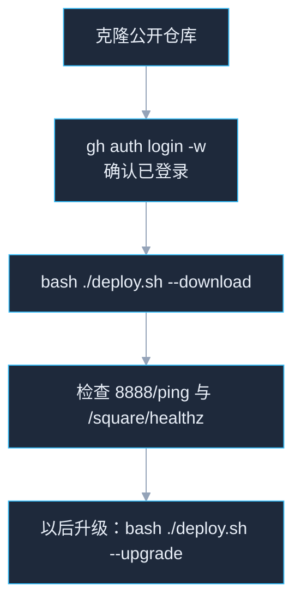
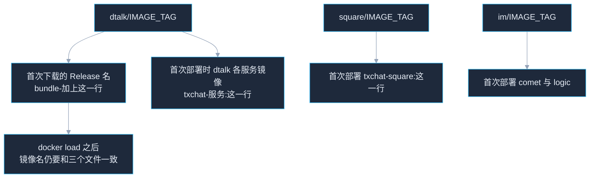

# TXChat 运行目录

> **免责声明**
>
> 本项目的全部内容，包括但不限于代码、文件和技术资料，只供学习、研究使用。请勿用于学习、研究以外的其他用途。

单集群部署用的运行目录。程序在 Docker 镜像里，镜像在本仓库的 GitHub Release 附件中。本仓库只放 compose、SQL、Nginx、Redis 配置和初始化脚本。

对外入口是宿主机 **8888**。不需要 Go，不需要源码，也不需要访问 Docker Hub。

| 项 | 内容 |
|---|---|
| 系统 | x86_64 Linux。镜像是 linux/amd64 |
| Docker Engine | 20.10+ |
| Docker Compose | v2，命令是 `docker compose`。没有时 `deploy.sh` 会自动安装插件 |
| 其它 | bash、openssl、gh。`openssl` 用来生成密码，`gh` 用来下载 Release |
| 硬件 | 单机试运行建议至少 4 核、8 GB 内存、50 GB 磁盘 |

镜像标签写在 `dtalk/IMAGE_TAG`、`im/IMAGE_TAG` 和 `square/IMAGE_TAG`。三边标签可以不同。第一次下载的 Release 名是 `bundle-` 加上 `dtalk/IMAGE_TAG`。这一份里同时有 dtalk、im、中间件、`txchat-square` 和 `postgres:16-alpine`。三个文件各管什么、和 Release 对不上时怎么处理，见下面的「镜像标签文件」。

如果要自动化部署，请参考本文档说明。不跑脚本、要逐步执行时看 [手动部署.md](手动部署.md)。页面打不开、登录 403、图片上传失败时看 [问题分析与解答.md](问题分析与解答.md)。



---

## 镜像标签文件

三个文件各一行，就是镜像标签本身。不要加引号，行首行尾不要空格。`deploy.sh` 读整行。文件空着或缺失时脚本直接退出。



| 文件 | 作用 |
|---|---|
| `dtalk/IMAGE_TAG` | `--download` 默认请求的 Release 是 `bundle-` 加上这一行。首次生成 `dtalk/.env` 时，answer、backend、gateway、oss 等 dtalk 服务的 `*_IMAGE` 都写成这一行 |
| `square/IMAGE_TAG` | 首次生成 `square/.env` 时写入 `SQUARE_IMAGE`。不参与 Release 名。整包里的广场镜像和 dtalk 用同一个标签，所以首次发布时这一行与 `dtalk/IMAGE_TAG` 相同 |
| `im/IMAGE_TAG` | 首次写入 `COMET_IMAGE`、`LOGIC_IMAGE`。不参与 Release 名，可以和 dtalk 不同 |

`--download` 不看 GitHub 页面上的 Latest。后面单独发的 `chatadmin-<标签>` 不会在这次下载里。

已经有 `.env` 之后，正在跑的标签在 `.env` 里，例如 `GATEWAY_IMAGE`、`COMET_IMAGE`、`SQUARE_IMAGE`。`bash ./deploy.sh --upgrade` 只改这些键，不改三个 `IMAGE_TAG` 文件。新机器第一次部署仍然下载 `bundle-<dtalk/IMAGE_TAG>`，装上的是这一份完整包，再执行 `--upgrade` 才会换成更新的单模块包。

`--release` 只改从哪个 GitHub Release 下载。下载完之后，脚本仍按三个 `IMAGE_TAG` 检查本机镜像，例如 `txchat-gateway:$(cat dtalk/IMAGE_TAG)`。只改 `--release`、不改 `IMAGE_TAG`，tar 能下来，接着会报镜像不存在。

打包机上的 `DTALK_TAG` 必须和推到 `main` 的 `dtalk/IMAGE_TAG`、`square/IMAGE_TAG` 逐字相同，`IM_TAG` 必须和 `im/IMAGE_TAG` 逐字相同。对方 clone 的是 `main`，读不到打包机上的环境变量。发布前先改这三个文件并推送，对方先 `git pull`，再 `--download`。

`git describe` 指向的是最近一个 git 标签。最近标签若是 `chatadmin-v1.1.0-pre-16-ga90b3b4c` 这种模块标签，后面又有提交，描述结果会变成 `chatadmin-v1.1.0-pre-16-ga90b3b4c-10-ga90b3b4c`。拿它做 `bundle-` Release，和仓库里仍是 `v1.1.0-pre-14-g0dcc8081` 的 `dtalk/IMAGE_TAG` 对不上。整包标签用 `v` 开头的版本。输出里带 `chatadmin-`、`gateway-` 这类模块名前缀，或在已经含 `-g` 的标签后面又接了一段 `-数字-g`，不要用这个字符串去 `docker build`、`docker save` 和 `gh release create`。

`gh: Not Found (HTTP 404)` 表示 `bundle-<dtalk/IMAGE_TAG>` 这个 Release 标签不存在。脚本下一行的「访问 GitHub 时连接被重置」可以忽略，多试几次也不会出现这个 Release。在运行目录核对：

```bash
echo "bundle-$(cat dtalk/IMAGE_TAG)"
gh release view "bundle-$(cat dtalk/IMAGE_TAG)" --repo web3chat/txchat-release
gh release list --repo web3chat/txchat-release
```

`release not found` 时，以 `gh release list` 里的 tag 和附件文件名为准。`txchat-gateway-<标签>.tar` 里的 `<标签>` 才是 `docker load` 之后的镜像名。dtalk 各服务 tar 的标签写入 `dtalk/IMAGE_TAG`，广场 tar 的标签写入 `square/IMAGE_TAG`，`txchat-comet-`、`txchat-logic-` 的标签写入 `im/IMAGE_TAG`。三边按 tar 文件名写，不要假设和 Release 名相同。然后：

```bash
bash ./deploy.sh --download --release <gh release list 里的 tag>
```

只在这一台服务器上改 `IMAGE_TAG`、不推到 `main`，这台机器可以装上。其他机器 `git clone` 仍是旧的一行。要给以后的新机器用，把同样的三行推到 `main`。

不要为了改标题删掉唯一的一份 bundle。删掉之后，`IMAGE_TAG` 仍是旧行的机器会 404。标成 Latest 的单模块包不能代替第一次的全套镜像。

---

## 第一次部署

本仓库是公开的，克隆不需要私有仓库权限。`deploy.sh --download` 通过 `gh` 访问 GitHub API，未登录时 `gh` 会拒绝请求。用任意 GitHub 账号登录一次即可，不需要是本仓库成员。

```bash
git clone git@github.com:web3chat/txchat-release.git /path/to/txchat-release
cd /path/to/txchat-release
```

已经登录过时，跳过下面的登录，直接执行 `gh auth status`。部署机通常没有浏览器，用设备码登录：

```bash
gh auth login -h github.com -p https -w
```

终端会打印一次性代码和 `https://github.com/login/device`。在有浏览器的电脑上打开这个网址，用任意 GitHub 账号登录，填入代码。回到部署机，看到登录成功后确认：

```bash
gh auth status
```

输出里有 `Logged in to github.com` 再下载：

```bash
bash ./deploy.sh --download
```

脚本会下载 `bundle-<dtalk/IMAGE_TAG>`，`docker load` 每个 tar，初始化 dtalk、im 和 square，把 toml 拷进空的配置卷，然后按顺序启动：先 MySQL，再 im，再 square，最后 dtalk。广场使用单独的 PostgreSQL。Nginx 要解析 `txchat-square`，所以广场先于 dtalk 启动。

这次下载的 Release 名固定是 `bundle-` 加上 `dtalk/IMAGE_TAG`。GitHub 上标成 Latest 的后续发布不会被这次下载。后面单独发出的模块包要等首次部署完成，再执行 `bash ./deploy.sh --upgrade`。版本怎么挑，见下面的「升级」。

镜像 tar 已经在本机时：

```bash
bash ./deploy.sh --images-dir /path/to/tars
```

本机已经 `docker load` 过时，直接 `bash ./deploy.sh`。

再次执行时，已有的 `dtalk/.env`、`im/.env` 和 `square/.env` 不会重新生成密码。卷和 toml 已经存在时，不会重跑 `initwork.sh`，也不会覆盖配置卷。这时脚本只按现有 `.env` 把容器拉起来。`.env` 和 `dtalk/key` 不要提交。

广场运营台从 `http://<本机>:8888/square/console/` 登录。脚本会把本机地址补进 `square/.env` 的 `SQUARE_CORS`，并把 Nginx 里广场这段的 `Host` 改成带端口的 `$http_host`。公网地址不在网卡上时，执行前设置 `SQUARE_PUBLIC_HOST`，例如 `SQUARE_PUBLIC_HOST=203.0.113.10 bash ./deploy.sh`。只允许 `127.0.0.1` 时，从公网打开会登录失败并显示 403。

脚本跑完仍然 403 时，把下面的 `203.0.113.10` 换成浏览器地址栏里的主机，在发布目录执行。改完要重建广场容器，只改 `.env` 不会生效。

```bash
cd /path/to/txchat-release/square
python3 - <<'PY'
from pathlib import Path
p = Path(".env")
host = "203.0.113.10"
val = ",".join([
    f"http://{host}:8888",
    f"http://{host}:18100",
    "http://127.0.0.1:8888",
    "http://127.0.0.1:18100",
])
lines, found = [], False
for line in p.read_text().splitlines():
    if line.startswith("SQUARE_CORS="):
        lines.append("SQUARE_CORS=" + val)
        found = True
    else:
        lines.append(line)
if not found:
    lines.append("SQUARE_CORS=" + val)
p.write_text("\n".join(lines) + "\n")
print("ok")
PY
docker compose up -d --no-build --force-recreate square
```

| 参数 | 作用 |
|---|---|
| `--download` | 用 `gh` 下载 `bundle-<dtalk/IMAGE_TAG>` 并 `docker load`。GitHub 连接中断时按文件续传重试 |
| `--images-dir DIR` | 加载该目录下的 `.tar` |
| `--release NAME` | 配合 `--download`，指定别的 Release 名。默认是 `bundle-<dtalk/IMAGE_TAG>` |
| `--skip-seed` | 不拷贝 toml |
| `--force-seed` | 用镜像里的 toml 覆盖配置卷 |
| `--reinit` | 卷缺失且镜像标签已经改过时，仍执行 `initwork.sh`。这会把 `.env` 里的业务镜像标签写回 `IMAGE_TAG` |
| `--down` | 删除全部容器。保留数据卷、配置卷、`.env` 和镜像 |
| `--purge` | 删除全部容器，以及本机由下载加载的全部镜像和 tar。见「清空下载的镜像」 |

---

## 验收

```bash
curl -sS -o /dev/null -w '%{http_code}\n' http://127.0.0.1:8888/ping
curl -sS http://127.0.0.1:8888/square/healthz
```

`/ping` 是 200。`/square/healthz` 的正文是 `{"ok":true}`。客户端连接 `http://宿主机:8888`，WebSocket 是 `ws://宿主机:8888/sub/`。Nginx 把 `/sub/` 转到 comet 的 `/sub`。

两个账号的私聊收发用 `verify-chat.sh`。它把 [im-util](https://github.com/txchat/im-util) 的 `v0.1.0` 下载到临时目录，编译 `pressure`，用 `pre` 发私聊，再用 `ana` 统计。一条消息要同时有发送、接收和回执才算通过。脚本会把客户端路径改成 `/sub/`，与上面的 Nginx 转发一致。需要 `bash`、`git` 和 `go`。没有 `users.txt` 时会用下载下来的钱包命令生成两个账号，文件含私钥，不要提交。

```bash
cd /path/to/txchat-release
sh ./verify-chat.sh
```

换入口时设置 `SERVER`，例如 `SERVER=10.0.0.8:8888`。持续秒数用 `TIMEOUT`，默认 `20`。`pressure` 结束后还会再等 30 秒收后续消息。仓库或标签用 `IM_UTIL_REPO`、`IM_UTIL_REF`。

---

## 升级

仓库里有新的业务模块，或某个模块发了更新的标签时：

```bash
bash ./deploy.sh --upgrade
```

`--upgrade` 不能代替第一次部署。`dtalk/.env` 或 `im/.env` 还不存在时，它会直接退出。

它会列出这个仓库全部 Release 里的 tar，按附件上传时间给每个模块留最新的一张，附件名要是 `txchat-<模块>-<标签>.tar`。和 `.env` 里的镜像标签不同时，下载这一张、`docker load`，只重建这一个容器，成功后再写入新标签。标签相同且容器已在跑的模块跳过。不重跑 `initwork`，不改数据库密码，不更换 MySQL、Kafka、Redis、etcd、MinIO、Nginx、PostgreSQL。挑选依据是附件的上传时间，不是 Release 的序号。中间发布过、但不是该模块最新一张的包，不会装上。

以当前仓库的发布为例。`dtalk/IMAGE_TAG` 是 `v1.1.0-pre-14-g0dcc8081`。

| 顺序 | Release | 附件 |
|---|---|---|
| 第一次 | `bundle-v1.1.0-pre-14-g0dcc8081` | 全套镜像，其中 chatadmin、square 都是 `v1.1.0-pre-14-g0dcc8081` |
| 第二次 | `chatadmin-v1.1.0-pre-16-ga90b3b4c` | 只有 `txchat-chatadmin-v1.1.0-pre-16-ga90b3b4c.tar` |
| 若再有第三次 | 同时带 chatadmin 和 square 的新标签 | `txchat-chatadmin-<新标签>.tar`、`txchat-square-<新标签>.tar`，且上传时间晚于前两次 |

全新机器先执行 `bash ./deploy.sh --download`，装上的是第一次完整包。chatadmin 和 square 都是 `v1.1.0-pre-14-g0dcc8081`。第二次、第三次都不在这次下载里。

然后执行 `bash ./deploy.sh --upgrade`。第三次比前两次都晚时，chatadmin 从 `v1.1.0-pre-14-g0dcc8081` 直接换成第三次的标签，第二次的 `v1.1.0-pre-16-ga90b3b4c` 不会装上；square 换成第三次的标签。gateway、oss、comet 等只有完整包里那一张，标签未变就跳过。数据卷和 `.env` 里的密码保持不动。广场在首次部署时已经在跑，这次不会为了它再重启 Nginx。

若第三次里的 chatadmin 反而比第二次传得更早，升级会留下 `v1.1.0-pre-16-ga90b3b4c`。

要手工改某一个容器时，看 [手动部署.md](手动部署.md) 的「手工升级一个模块」。

---

## 修改配置

正在跑的配置在 Docker 卷里。第一次部署时从镜像或仓库拷进这些卷，之后容器读的是卷。改仓库里的 `dtalk/conf.d/dtalk.conf`、`im/redis.conf` 不会进已经启动的容器。这些卷是外部卷，名字没有项目名前缀。

| 配置 | 卷 | 容器里的路径 |
|---|---|---|
| dtalk 各业务 toml | `txchat-<服务>-config`，例如 `txchat-gateway-config` | `/etc/txchat-<服务>/config/<服务>.toml` |
| comet、logic | `txchat-comet-config`、`txchat-logic-config` | `/etc/comet/config/comet.toml`、`/etc/logic/config/logic.toml` |
| Nginx | `txchat-nginx-config` | `/etc/nginx/conf.d/dtalk.conf` |
| Redis | `txchat-redis-config` | `/usr/local/etc/redis/redis.conf` |

改某个业务 toml 时，先拷出来改，再拷回去，只重启这一个容器。以 gateway 为例：

```bash
docker run --rm -v txchat-gateway-config:/cfg alpine cat /cfg/gateway.toml > /tmp/gateway.toml
# 编辑 /tmp/gateway.toml
docker run --rm -v txchat-gateway-config:/cfg -v /tmp/gateway.toml:/in/gateway.toml alpine \
  cp /in/gateway.toml /cfg/gateway.toml

cd /path/to/txchat-release/dtalk
docker compose -f components.compose.yaml -f service.compose.yaml \
  up -d --no-deps --no-build gateway
```

其它业务 toml 把卷名、文件名和服务名换成上一张表里的对应项。comet、logic 在 `im/` 目录执行同样的 compose 命令。

Nginx 和 Redis 同样改对应的卷，然后只重启 `txchat-nginx` 或 `txchat-redis`（容器名以 `.env` 里的 `NGINX_CONTAINER_NAME`、`REDIS_CONTAINER_NAME` 为准）：

```bash
docker run --rm -v txchat-nginx-config:/cfg alpine cat /cfg/dtalk.conf > /tmp/dtalk.conf
# 编辑 /tmp/dtalk.conf
docker run --rm -v txchat-nginx-config:/cfg -v /tmp/dtalk.conf:/in/dtalk.conf alpine \
  cp /in/dtalk.conf /cfg/dtalk.conf
docker restart txchat-nginx

docker run --rm -v txchat-redis-config:/cfg alpine cat /cfg/redis.conf > /tmp/redis.conf
# 编辑 /tmp/redis.conf
docker run --rm -v txchat-redis-config:/cfg -v /tmp/redis.conf:/in/redis.conf alpine \
  cp /in/redis.conf /cfg/redis.conf
docker restart txchat-redis
```

不要重跑 `initwork.sh`，也不要再把镜像里的 toml 拷进配置卷，那会盖掉已经改过的内容。

### 改 discovery 的聊天节点和合约节点

文件在卷 `txchat-discovery-config` 的 `discovery.toml`。`[[CNodes]]` 是客户端可选的聊天入口，`[[DNodes]]` 是合约节点。两段都要填 `name` 和 `address`。`CNodes.address` 填客户端访问本集群的地址，单集群一般是 `http://<本机>:8888`。`DNodes.address` 填 Chain33 RPC 地址。多台就再写一段 `[[CNodes]]` 或 `[[DNodes]]`。原来 `name`、`address` 都空的那段要改掉，不要留着。

```toml
[[CNodes]]
name="本集群"
address="http://<本机>:8888"

[[DNodes]]
name="合约节点"
address="http://<链节点地址>"
```

discovery 启动时按 `name` 写入 Redis（`find:chat_node`、`find:chain33_node`）。改名或删掉某一段之后，旧名字还会留在列表里。先更新文件，删掉这两份旧列表，再只重启 discovery：

```bash
docker run --rm -v txchat-discovery-config:/cfg alpine cat /cfg/discovery.toml > /tmp/discovery.toml
# 编辑 /tmp/discovery.toml 里的 [[CNodes]] 和 [[DNodes]]
docker run --rm -v txchat-discovery-config:/cfg -v /tmp/discovery.toml:/in/discovery.toml alpine \
  cp /in/discovery.toml /cfg/discovery.toml

docker exec txchat-redis redis-cli DEL find:chat_node find:chain33_node

cd /path/to/txchat-release/dtalk
docker compose -f components.compose.yaml -f service.compose.yaml \
  up -d --no-deps --no-build discovery
```

容器名以 `.env` 里的 `DISCOVERY_CONTAINER_NAME` 为准，默认是 `txchat-discovery-node1`。确认：

```bash
curl -sS -X POST http://127.0.0.1:8888/disc/nodes
```

返回里的 `servers` 对应 `CNodes`，`nodes` 对应 `DNodes`。

广场没有 toml 卷。改 `square/.env` 后，在 `square/` 里执行 `docker compose up -d --no-build`。已有运营台账号的密码不会跟着变。

### 给 chatadmin 加管理员

管理页是 `http://宿主机:18020/`。端口以 `dtalk/.env` 的 `CHATADMIN_HTTP_PUB_PORT` 为准，默认 `18020`。登录时用小狐狸对白名单里的地址签名。白名单在 MySQL 库 `dtalk` 的 `groupmanage_admin_whitelist`。`status` 为 1 才能登录。`level` 为 1 是超级管理员，0 是普通管理员。地址按小写保存。

在 `dtalk` 目录执行，把地址换成自己的小狐狸地址：

```bash
cd /path/to/txchat-release/dtalk
ADDR='0x你的小狐狸地址'
PW=$(sed -n 's/^MYSQL_ROOT_PASSWORD=//p' .env)
MYSQL=$(sed -n 's/^MYSQL_CONTAINER_NAME=//p' .env)
MYSQL=${MYSQL:-txchat-mysql}
docker exec -i "$MYSQL" mysql -uroot -p"$PW" dtalk <<SQL
INSERT INTO groupmanage_admin_whitelist
  (address, remark, status, level, created_by, created_at, updated_at)
VALUES
  (LOWER('${ADDR}'), '管理员', 1, 1, 'init', UNIX_TIMESTAMP()*1000, UNIX_TIMESTAMP()*1000)
ON DUPLICATE KEY UPDATE
  status=1, level=1, updated_at=UNIX_TIMESTAMP()*1000;

SELECT address, status, level
FROM groupmanage_admin_whitelist
WHERE address=LOWER('${ADDR}');
SQL
```

`MYSQL_CONTAINER_NAME` 为空时用 `txchat-mysql`。同一地址再执行一次会把状态改回启用。确认查询里 `status` 是 1 后，用这个钱包打开管理页登录。

---

## 停机与清空广场库

关掉并删除全部容器。数据卷、配置卷、`.env` 和镜像都保留，下次 `bash ./deploy.sh` 会按现有配置再拉起来：

```bash
bash ./deploy.sh --down
```

广场库是以前留下的、运营台密码对不上时，只清广场的 PostgreSQL，再按当前 `square/.env` 重建库和管理员。MySQL 不动：

```bash
bash ./deploy.sh --reset-square-pg
bash ./deploy.sh
```

---

## 清空下载的镜像

`bash ./deploy.sh --purge` 把这台机器上由本仓库下载并 `docker load` 的镜像全部去掉，同时删除已经启动的容器。下载目录 `/tmp/txchat-images` 里的 tar 也删除。执行完之后，本机不再保留这些镜像，也不能靠留下的 tar 再加载。

它适合两种情况：本机不想继续留着这批镜像；或者要确认下一轮 `bash ./deploy.sh --download` 是重新下载、重新加载。

会删除：

- dtalk、im、square 已经启动的容器
- `/tmp/txchat-images` 每个 tar 里记录的镜像名，包含首次完整包和后来 `--upgrade` 单独加载的标签
- 本机全部 `txchat-*` 镜像。清完若还剩 `txchat-*`，命令失败退出
- 这份部署用到的 MySQL、Nginx、MinIO、Redis、etcd、Kafka、ZooKeeper、PostgreSQL，以及 bundle 里的 `hello-world`、`alpine`
- `/tmp/txchat-images` 目录

数据卷、配置卷和 `.env` 保留，密码不会重算。用 `--images-dir` 另外存放的 tar 目录不删，但其中已经加载进 Docker 的镜像同样会被删掉。

```bash
bash ./deploy.sh --purge
```

要再部署时重新下载：

```bash
bash ./deploy.sh --download
```
