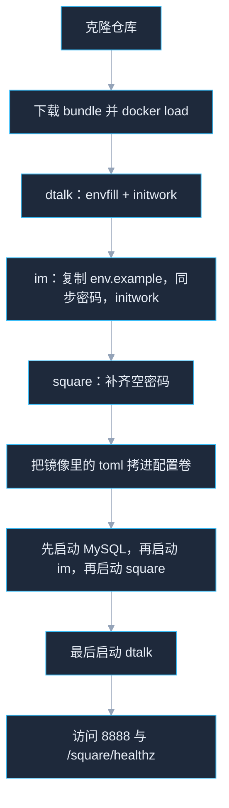

# 手动部署

> **免责声明**
>
> 本项目的全部内容，包括但不限于代码、文件和技术资料，只供学习、研究使用。请勿用于学习、研究以外的其他用途。

不使用 `deploy.sh` 时，按下面的顺序在 x86_64 Linux 上逐步执行。日常部署、升级、停机用仓库根目录的 [README.md](README.md)。登录 403、图片上传失败时看 [问题分析与解答.md](问题分析与解答.md)。

这次发布不启动联邦，也不部署 Presence。对外入口是宿主机 **8888**。广场使用单独的 PostgreSQL，不进 dtalk 的 MySQL。下面把仓库克隆到的目录写成 `/path/to/txchat-release`。

镜像标签写在 `dtalk/IMAGE_TAG`、`im/IMAGE_TAG` 和 `square/IMAGE_TAG`。三边可以不同。第一次的 Release 名是 `bundle-` 加上 `dtalk/IMAGE_TAG`。这一行还决定 `docker load` 之后要存在的镜像名。`gh: Not Found (HTTP 404)` 是这个 Release 标签不存在，不是网络中断。文件作用、和 `.env` 的差别、标签对不上时怎么改，见 [README.md](README.md) 的「镜像标签文件」。



---

## 1. 加载镜像

仓库是公开的，克隆不需要私有仓库权限。下载 Release 前用任意 GitHub 账号执行 `gh auth login`。

```bash
git clone git@github.com:web3chat/txchat-release.git /path/to/txchat-release
cd /path/to/txchat-release

gh release download "bundle-$(cat dtalk/IMAGE_TAG)" \
  --repo web3chat/txchat-release \
  --dir /tmp/txchat-images

for f in /tmp/txchat-images/*.tar; do
  docker load -i "$f"
done

docker image inspect "txchat-gateway:$(cat dtalk/IMAGE_TAG)" >/dev/null
docker image inspect "txchat-logic:$(cat im/IMAGE_TAG)" >/dev/null
docker image inspect "txchat-square:$(cat square/IMAGE_TAG)" >/dev/null
docker image inspect postgres:16-alpine >/dev/null
docker image inspect custom-nginx:1.19.2-alpine >/dev/null
```

任一 `docker image inspect` 失败，说明标签和本地镜像对不上，先不要继续。`hello-world`、`alpine`、`txchat-square` 和 `postgres:16-alpine` 都在同一份 bundle Release 里。页面上的 Source code 压缩包不是镜像，不要 `docker load`。

---

## 2. 初始化 dtalk

在本机生成密码，创建 Docker 网络 `txchat-components`、`txchat-service`，创建 MySQL、MinIO、Nginx 卷，并把 SQL 和 Nginx 站点配置写入卷。

必须先进入 `dtalk/` 再执行。脚本按当前目录读写 `.env` 和 SQL。

```bash
cd /path/to/txchat-release/dtalk
bash ./envfill.sh
DTALK_TAG=$(cat IMAGE_TAG)
bash ./initwork.sh \
  "answer backend backup call device discovery gateway generator group offline-push oss pusher store chatclean chatadmin" \
  "${DTALK_TAG}"
```

没有 `key` 文件时，`envfill.sh` 会自己生成 `MYSQL_ROOT_PASSWORD` 和 `MINIO_ROOT_PASSWORD`，写进 `dtalk/.env`。不要改 `FEDERATION_ENABLED`，模板默认是 `false`。`COMPOSE_PROFILES` 保持为空，federation 服务不会启动。

核对标签和开关，不要把密码贴到聊天或工单里：

```bash
grep -E '^(GATEWAY_IMAGE|FEDERATION_ENABLED|COMPOSE_PROFILES)=' .env
```

`GATEWAY_IMAGE` 应等于 `IMAGE_TAG`。`FEDERATION_ENABLED` 应为 `false`。

---

## 3. 初始化 im

im 的 logic 连接 dtalk 的 MySQL，密码必须相同。先复制模板，再显式指定 dtalk 的 `.env`。这个仓库的目录和源码仓库不同，不指定 `DTALK_ENV` 时脚本找不到密码文件。

```bash
cd /path/to/txchat-release/im
cp env.example .env

DTALK_ENV=/path/to/txchat-release/dtalk/.env \
  bash ./sync-mysql-from-dtalk.sh /path/to/txchat-release/im

IM_TAG=$(cat IMAGE_TAG)
bash ./initwork.sh "comet logic" "${IM_TAG}"
```

同步的是 `MYSQL_ROOT_PASSWORD`、`CLUSTER_ID`、`PRESENCE_URL`。单集群下 `PRESENCE_URL` 为空。`COMET_IMAGE` 和 `LOGIC_IMAGE` 应等于 `im/IMAGE_TAG`。

---

## 4. 初始化 square

广场不进 dtalk 的 MySQL。数据库是 `postgres:16-alpine`，容器名 `txchat-square-pg`。运营台页面已经打进 `txchat-square` 镜像。

`dtalk/initwork.sh` 会创建网络 `txchat-components`。广场的 compose 把这张网络标成 external，所以要先完成上一节的 dtalk 初始化，再启动广场。

```bash
cd /path/to/txchat-release/square
cp env.example .env
```

三个密码和 `SQUARE_OSS_PRIVKEY` 在这台机器上生成，不要从打包机复制。已有值不要重写。OSS 私钥是 64 位十六进制的 secp256k1 私钥，只用于运营台代传图片时签发签名。字段为空时再补上。

```bash
openssl rand -hex 24    # SQUARE_PG_PASSWORD
openssl rand -hex 32    # SQUARE_JWT_SECRET，至少 32 位
openssl rand -base64 18 # SQUARE_BOOTSTRAP_ADMIN_PASSWORD，至少 12 位，不要含逗号、冒号或 $
```

`SQUARE_IMAGE` 应等于 `square/IMAGE_TAG`。`SQUARE_BOOTSTRAP_ADMIN_USER` 默认是 `admin`。

`SQUARE_CORS` 要包含浏览器打开运营台的来源，例如 `http://<公网地址>:8888` 和 `http://<公网地址>:18100`。模板里只有 `http://127.0.0.1:8888`。从公网 `:8888` 登录时来源对不上，广场会回空的 403，页面显示 `Unexpected end of JSON input`。`deploy.sh` 会探测本机网卡、云主机公网地址，或使用执行前设置的 `SQUARE_PUBLIC_HOST`，把这些来源补进已有值，不删掉已经写过的地址。

仍然 403 时，把下面的 `203.0.113.10` 换成浏览器地址栏里的主机，写进 `square/.env` 后重建广场容器。

```bash
cd /path/to/txchat-release/square
python3 - <<'PY'
from pathlib import Path
p = Path(".env")
host = "203.0.113.10"
val = ",".join([
    f"http://{host}:8888",
    f"http://{host}:18100",
    "http://127.0.0.1:8888",
    "http://127.0.0.1:18100",
])
lines, found = [], False
for line in p.read_text().splitlines():
    if line.startswith("SQUARE_CORS="):
        lines.append("SQUARE_CORS=" + val)
        found = True
    else:
        lines.append(line)
if not found:
    lines.append("SQUARE_CORS=" + val)
p.write_text("\n".join(lines) + "\n")
print("ok")
PY
docker compose up -d --no-build --force-recreate square
```

`deploy.sh` 在 `square/.env` 不存在时复制模板，并且只给仍为空的这三个密码和 `SQUARE_OSS_PRIVKEY` 生成新值。PostgreSQL 数据卷已经有数据时，它还会把库用户 `square` 的密码改成当前 `.env` 里的值，避免广场报 `28P01`。

---

## 5. 把 toml 拷进配置卷

业务镜像里已经带有默认 toml。compose 把外部卷挂到同一目录，空卷会挡住镜像里的文件。第一次安装时，在启动前把配置从镜像拷出来。卷挂到 `/out`，不要挂到镜像原来的配置目录上。

```bash
DTALK_TAG=$(cat /path/to/txchat-release/dtalk/IMAGE_TAG)
IM_TAG=$(cat /path/to/txchat-release/im/IMAGE_TAG)

seed_config() {
  image="$1"
  src="$2"
  volume="$3"
  docker run --rm --entrypoint sh \
    -v "${volume}:/out" \
    "${image}" \
    -c "cp -a ${src}/. /out/"
}

for name in answer backend backup call device discovery gateway generator group offline-push oss pusher store chatclean chatadmin; do
  seed_config "txchat-${name}:${DTALK_TAG}" \
    "/etc/txchat-${name}/config" \
    "txchat-${name}-config"
done

seed_config "txchat-comet:${IM_TAG}" /etc/comet/config txchat-comet-config
seed_config "txchat-logic:${IM_TAG}" /etc/logic/config txchat-logic-config
```

只在第一次安装时做。以后改过配置卷里的 toml，不要再跑这段，否则会盖掉改动。

MySQL 密码不写进 toml。logic、gateway 等容器启动时由 compose 注入 `MYSQL_PASSWORD`，值来自各自的 `.env`。

---

## 6. 启动

先只启动 MySQL，等它健康后再启动 im。logic 起来时就要连接 `txchat-mysql`。Redis、Kafka、etcd 在 im 这边，dtalk 的其它业务要连它们。im 起来之后先启动 square，最后才启动整个 dtalk。Nginx 的 `upstream square` 指向 `txchat-square:18100`，广场容器不在 `txchat-components` 里时 Nginx 起不来。

```bash
cd /path/to/txchat-release/dtalk
docker compose -f components.compose.yaml -f service.compose.yaml up -d --no-deps mysql

cd /path/to/txchat-release/im
docker compose -f components.compose.yaml -f service.compose.yaml up -d

cd /path/to/txchat-release/square
docker compose up -d --no-build
curl -sS http://127.0.0.1:18100/square/healthz

cd /path/to/txchat-release/dtalk
docker compose -f components.compose.yaml -f service.compose.yaml up -d
```

`18100` 上应返回 `{"ok":true}` 后再启动 dtalk。

数据卷不是空的、广场日志是 `password authentication failed` 时，库里的密码还是第一次初始化时的值。在 `square/` 目录把库密码改成当前 `.env`，不要把密码打到终端以外的地方：

```bash
pw=$(grep '^SQUARE_PG_PASSWORD=' .env | cut -d= -f2-)
docker exec -i txchat-square-pg \
  psql -U square -d square -v ON_ERROR_STOP=1 -v pass="$pw" <<'SQL'
ALTER USER square PASSWORD :'pass';
SQL
docker restart txchat-square
```

`deploy.sh` 启动广场时会做同样的对齐。

不要加 `--build`。dtalk 的 Nginx 段里带有 `build:`，加了会按目录里的 Dockerfile 重编。镜像已经 `docker load` 过，直接使用 `custom-nginx:1.19.2-alpine`。

MySQL 只在数据卷为空的第一次启动时执行初始化 SQL。卷里已经有数据时，更换 SQL 文件不会自动建表。

---

## 7. 验收

1. `im/.env` 的 `MYSQL_ROOT_PASSWORD` 与 `dtalk/.env` 相同。对比时不要把密码打到终端历史以外的地方。
2. `dtalk/.env` 里 `FEDERATION_ENABLED=false`，`COMPOSE_PROFILES` 为空。没有名为 `txchat-federation-node1` 的容器。
3. 业务容器为 Up：

```bash
cd /path/to/txchat-release/im
docker compose -f components.compose.yaml -f service.compose.yaml ps

cd /path/to/txchat-release/square
docker compose ps

cd /path/to/txchat-release/dtalk
docker compose -f components.compose.yaml -f service.compose.yaml ps
```

4. gateway 的配置卷里能看到 toml：

```bash
docker run --rm -v txchat-gateway-config:/cfg:ro alpine \
  ls /cfg/gateway.toml
```

5. `curl http://127.0.0.1:8888/ping` 返回 200。`/` 转到 gateway，`/sub` 转到 comet。
6. `curl http://127.0.0.1:18100/square/healthz` 和 `curl http://127.0.0.1:8888/square/healthz` 都是 HTTP 200，正文为 `{"ok":true}`。
7. 两个用户登录，私聊能发出并收到。建一个群，双方能收发。

客户端连接 `http://宿主机:8888`。WebSocket 地址是 `ws://宿主机:8888/sub`。

---

## 8. 手工升级一个模块

已经部署过的机器优先用 `bash ./deploy.sh --upgrade`，见 [README.md](README.md)。下面是不跑该命令时，只换一个容器的做法。

下载该模块的新镜像，只改 `.env` 里对应的镜像标签，然后只重建这一个容器。不要重跑 `envfill.sh` 或 `initwork.sh`，否则会生成新的 MySQL 密码，已有数据卷对不上。

以 gateway 为例。`TAG` 是这次 Release 说明里的新标签，不要复用正在运行的旧标签。

```bash
gh release download "gateway-${TAG}" \
  --repo web3chat/txchat-release \
  --dir /tmp/txchat-images
docker load -i /tmp/txchat-images/txchat-gateway-${TAG}.tar

cd /path/to/txchat-release/dtalk
# 编辑 .env，只改这一行：
# GATEWAY_IMAGE=上面的 TAG

docker compose -f components.compose.yaml -f service.compose.yaml \
  up -d --no-deps --no-build gateway
```

`--no-deps` 不带动 MySQL、Nginx 和其它业务容器。容器名仍是 `.env` 里的 `GATEWAY_CONTAINER_NAME`（默认 `txchat-gateway-node1`）。

这次只换程序时，不要把镜像里的 toml 再拷进配置卷。配置卷会盖住镜像内的配置，重拷会盖掉已经改过的 toml。

其它模块同样处理：Release 里只有那一张 tar，只改对应的 `*_IMAGE`，再 `up -d --no-deps --no-build 服务名`。

| 服务名 | `.env` 里的标签 | 在哪个目录执行 |
|---|---|---|
| `gateway` `backend` `backup` `call` `device` `discovery` `generator` `group` `offline-push` `oss` `answer` `pusher` `store` `chatclean` `chatadmin` | 同名大写加 `_IMAGE`，例如 `GATEWAY_IMAGE`、`OFFLINE_PUSH_IMAGE` | `dtalk/` |
| `comet` `logic` | `COMET_IMAGE`、`LOGIC_IMAGE` | `im/` |
| `square` | `SQUARE_IMAGE` | `square/`，命令是 `docker compose up -d --no-build` |

compose、SQL 或 Nginx 配置有变更时，再 `git pull`。本机的 `.env` 不在仓库里，`git pull` 不会改掉已经生成的密码和镜像号。pull 之后如果 compose 文件变了，对受影响的服务再执行一次 `up -d --no-deps --no-build`。

中间件（MySQL、Kafka、Redis、etcd、MinIO）不要随业务镜像一起换。那些镜像和数据卷绑在一起，升级要单独备份。

---

## 9. 不要提交、不要重做的文件

| 文件 | 说明 |
|---|---|
| `dtalk/.env`、`im/.env`、`square/.env` | 本机密码和镜像标签。`.gitignore` 已忽略 |
| `dtalk/key` | 若手工指定密码才会有。不要放进仓库，也不要回传 |
| 配置卷里改过的 toml | 升级程序时保留。只有确认要用镜像里的新配置覆盖时，才对那一个服务重跑第 5 节 |
