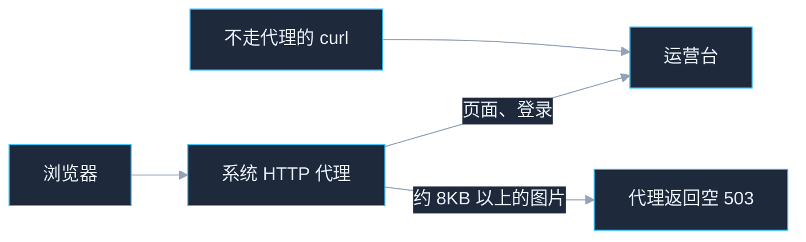
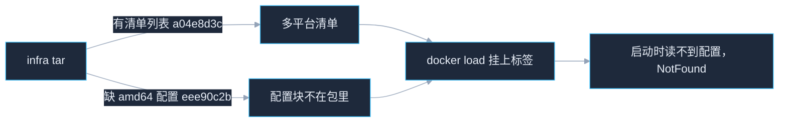
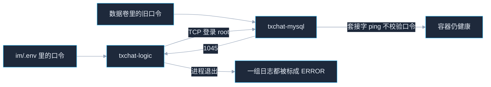

# 问题分析与解答

部署完成后，浏览器里的失败要先分清请求有没有到达服务。缩略图上的「失败」只表示这张图没有拿到地址，具体原因看开发者工具里的状态码和右下角红字。

命令里的 `203.0.113.10` 是占位主机，换成浏览器地址栏里的主机。运营台用 `http://<主机>:8888/square/console/`。直接打开容器端口是 `http://<主机>:18100/square/console/`，上传接口都是 `POST /square/admin/upload`。

改仓库里的 `dtalk/conf.d/dtalk.conf` 不会进已经启动的 Nginx。正在使用的配置在卷 `txchat-nginx-config`。写回卷的方法见 [README.md](README.md)「修改配置」。

---

## 图片缩略图显示「失败」，接口是空的 503

运营台能打开，纯文字帖可以发出。选图片后缩略图盖着「失败」，右下角是红色「上传失败」。`POST /square/admin/upload` 的状态是 **503**，响应体是空的，响应头里没有 `Server: nginx`。

`8888` 和 `18100` 会一起出现。服务器在境外、不在 VPN 的大陆直连名单里时，老集群用 `18100` 打开也一样。大陆地址通常被 VPN 直连，所以同一套运营台在大陆机器上开着 VPN 仍能上传。



原因是本机系统 HTTP 代理截住了明文上传。开启系统代理的 VPN 或代理软件会把浏览器的 HTTP 请求指到本机代理。运营台是明文 `http://`，浏览器把整段 POST 交给它转发。页面和登录体积小，能转到后面的服务。部分软件在图片大约超过 8KB 后自己返回 `HTTP/1.1 503`，正文为空。页面解析不到 JSON，缩略图就显示失败。只做虚拟网卡、不设置系统 HTTP 代理的 VPN，浏览器会直接连到运营台，一般不会出现这个空 503。

在服务器上执行 `square/test-post.py`，或者本机用下面这条不走代理的 curl，同一张图可以成功。未登录时状态仍是 **200**，正文是「未登录」，响应头里有 `Server: nginx`。这表示上传接口已经收到请求。

```bash
curl -sS -D - -o /dev/null \
  -F "file=@./1.jpeg;type=image/jpeg" -F "kind=picture" \
  "http://203.0.113.10:8888/square/admin/upload"
```

处理时不必退出整个 VPN。在它的直连或绕过规则里加上运营台主机，例如 `203.0.113.10`。改完重新打开运营台再上传。浏览器这条仍然是空 503，而这面 curl 已经是带 `Server: nginx` 的 200 时，按直连规则处理。

---

## 从 8888 打开运营台，登录是空的 403

`http://<主机>:8888/square/console/` 能打开，登录失败。页面提示 `Unexpected end of JSON input`，接口状态是 **403**，响应体是空的。直接打开 `:18100` 有时可以登录。

广场在来源既不是「`http://` + 请求里的 Host」，又不在 `SQUARE_CORS` 里时，回空的 403。这里有两处会叠在一起：

- `square/.env` 的 `SQUARE_CORS` 只有模板里的 `http://127.0.0.1:8888`，公网来源不在名单里。
- Nginx 若把 `Host` 设成 `$host`，端口会被去掉。浏览器来源仍是 `http://203.0.113.10:8888`，和 `http://203.0.113.10` 对不上。直连 `:18100` 时 Host 本身带端口，所以那边可以登录。

仓库里的 `location /square/` 使用 `proxy_set_header Host $http_host`。`deploy.sh` 会把本机和 `SQUARE_PUBLIC_HOST` 补进已有的 `SQUARE_CORS`，并在已有 Nginx 卷上改 Host、重载 Nginx。公网地址不在网卡上时，执行前设置 `SQUARE_PUBLIC_HOST=203.0.113.10`。

仍然 403 时，把下面的主机换成地址栏里的主机，在发布目录的 `square` 下执行。改完要重建广场容器，只改 `.env` 不会进正在运行的容器。

```bash
cd /path/to/txchat-release/square
python3 - <<'PY'
from pathlib import Path
p = Path(".env")
host = "203.0.113.10"
val = ",".join([
    f"http://{host}:8888",
    f"http://{host}:18100",
    "http://127.0.0.1:8888",
    "http://127.0.0.1:18100",
])
lines, found = [], False
for line in p.read_text().splitlines():
    if line.startswith("SQUARE_CORS="):
        lines.append("SQUARE_CORS=" + val)
        found = True
    else:
        lines.append(line)
if not found:
    lines.append("SQUARE_CORS=" + val)
p.write_text("\n".join(lines) + "\n")
print("ok")
PY
docker compose up -d --no-build --force-recreate square
```

然后确认正在使用的 Nginx 里，广场这段是 `Host $http_host`。旧卷仍是 `Host $host` 时，用仓库里的 `dtalk/conf.d/dtalk.conf` 写回 `txchat-nginx-config`，再重载。容器名以 `dtalk/.env` 的 `NGINX_CONTAINER_NAME` 为准，默认 `txchat-nginx`。`NGINX_VERSION` 也在这个文件里。卷在运行中的 Nginx 里是只读的，要用另一个容器写入。

```bash
cd /path/to/txchat-release
NGINX_VERSION=$(sed -n 's/^NGINX_VERSION=//p' dtalk/.env)
docker run --rm --entrypoint cp \
  -v txchat-nginx-config:/cfg \
  -v "$PWD/dtalk/conf.d/dtalk.conf:/in/dtalk.conf:ro" \
  "custom-nginx:${NGINX_VERSION}" \
  /in/dtalk.conf /cfg/dtalk.conf
docker exec txchat-nginx nginx -t
docker exec txchat-nginx nginx -s reload
```

卷里的 `dtalk.conf` 如果还改过仓库以外的 location，按这两处手工对齐，不要整文件覆盖：`location /square/` 的 Host 使用 `$http_host`，并保留下面一节的 `X-Square-Cors`。

---

## 上传返回 200，页面仍显示失败

不走代理的 curl 已经是 **200**，响应头里同时有两条 `Access-Control-Allow-Origin`：一条是 `http://203.0.113.10:8888`，另一条是 `*`。`Access-Control-Allow-Credentials` 也会出现两次。浏览器丢掉这份响应，页面仍显示「上传失败」。

Nginx 在 `server` 上写了 `Access-Control-Allow-Origin *`。`location` 里没有任何 `add_header` 时，这段会继承那条 `*`，再和广场自己返回的具体来源叠在一起。仓库里的 `location /square/` 加了 `add_header X-Square-Cors passthrough always;`，有了自己的 `add_header` 之后就不再继承 `*`。

用下面的命令看响应头。正常时 `Access-Control-Allow-Origin` 只有地址栏那一个来源，并带 `X-Square-Cors: passthrough`。

```bash
curl -sS -D - -o /dev/null \
  -H "Origin: http://203.0.113.10:8888" \
  -F "file=@./1.jpeg;type=image/jpeg" -F "kind=picture" \
  "http://203.0.113.10:8888/square/admin/upload"
```

旧卷没有这条头时，按上一节把仓库里的配置写回卷并重载。`deploy.sh` 再次执行时也会给已有卷补上 `X-Square-Cors` 并重载 Nginx。

---

## 广场的 OPTIONS 被 Nginx 直接 204

`server` 里若对所有 OPTIONS 执行 `return 204`，`/square/` 的预检到不了广场。这份 204 带着 `Access-Control-Allow-Origin: *` 和 `Access-Control-Allow-Credentials: true`，浏览器会取消后面的上传。

仓库里的配置先记下 OPTIONS，再对 `$uri` 以 `/square/` 开头的请求把这个标记清掉，预检继续交给广场。检查：

```bash
curl -sS -D - -o /dev/null -X OPTIONS \
  -H "Origin: http://203.0.113.10:8888" \
  -H "Access-Control-Request-Method: POST" \
  "http://203.0.113.10:8888/square/admin/upload"
```

仍是 Nginx 自己的 204，并且来源是 `*` 时，用仓库里的 `dtalk/conf.d/dtalk.conf` 写回卷再重载。`deploy.sh` 给旧卷打的补丁只改 Host 和 `X-Square-Cors`，不改这段 OPTIONS。

---

## 在自己的电脑上跑发帖脚本，提示缺少密钥

`python3 test-post.py` 或 `test-upload.py` 报 `缺少 SQUARE_JWT_SECRET 或 SQUARE_PG_PASSWORD`。

脚本要和 `square/.env` 放在一起，并向本机容器 `txchat-square-pg` 查询管理员。这两样都在服务器上。把 `.env` 拷到笔记本不够，笔记本上没有这个数据库容器。

在服务器的发布目录执行：

```bash
cd /path/to/txchat-release/square
python3 test-post.py --url http://127.0.0.1:8888 --file ./1.jpeg
```

脚本会发出两条真实官方帖，标题带当前时间。一条纯文字，一条带图片。

---

## 图片地址打开是 401

发帖脚本或 curl 访问图片 URL 得到 **401**，正文只有几十字节。图片文件本身可以公开读取。请求上若带着运营台的 `Authorization: Bearer ...`，对象存储不认这枚令牌，会回 401。

浏览器地址栏直接打开该 URL，或请求时不带这枚令牌，状态应是 **200**，大小与上传文件一致。当前的 `square/test-post.py` 检查图片时不发送运营台令牌。

---

## 清空镜像后重新加载，Kafka 启动报 `failed to read config content ... not found`

执行 `bash ./deploy.sh --purge` 后再 `--download`，`docker load` 仍打印 `Loaded image: ubuntu/kafka:3.1-22.04_beta`，但 im 启动时 `txchat-kafka` 报：

```
Error response from daemon: failed to read config content: NotFound:
content digest sha256:eee90c2b0c900fff9db80c2816e98c71bfd264202323618b0724194219fdf9ad: not found
```

同包里的 MySQL、Redis、ZooKeeper 都能读，只有 Kafka 坏。删镜像、重启 Docker、再加载都修不好。



原因在镜像包，不在 Docker。`ubuntu/kafka:3.1-22.04_beta` 是多平台清单，标签指向清单 `sha256:a04e8d3c…`，清单里又指向 amd64 配置 `sha256:eee90c2b…`。这份 infra tar 把清单写进去了，amd64 配置块没写进去。`docker load` 看到清单已存在就挂上标签，启动时才去读配置，于是 `NotFound`。这是 containerd 镜像库下 `docker save` 多平台镜像的已知问题：清单列表进了包，某个平台的配置块漏了。

第一次部署能跑，是因为那台机器之前已经 pull 过这个镜像，amd64 配置块本来就在内容库里。`--purge` 删掉了配置块文件，清单记录还在，再加载时 Docker 认为这块已存在不再重写，就再也补不回来。

在服务器上确认 tar 里确实没有这块：

```bash
TAR=/tmp/txchat-images/bundle-v1.1.0-pre-14-g0dcc8081/infra-v1.1.0-pre-14-g0dcc8081.tar
tar -tf "$TAR" | grep eee90c2b || echo "tar 里没有 eee90c2b"
```

然后从镜像源补回这块，再部署。不要加 `--download`：

```bash
docker pull ubuntu/kafka:3.1-22.04_beta
docker image history ubuntu/kafka:3.1-22.04_beta
cd /path/to/txchat-release
bash ./deploy.sh
```

Docker Hub 拉不动时用国内镜像：

```bash
docker pull swr.cn-north-4.myhuaweicloud.com/ddn-k8s/docker.io/ubuntu/kafka:3.1-22.04_beta
docker tag swr.cn-north-4.myhuaweicloud.com/ddn-k8s/docker.io/ubuntu/kafka:3.1-22.04_beta ubuntu/kafka:3.1-22.04_beta
docker image history ubuntu/kafka:3.1-22.04_beta
```

`deploy.sh` 导入时只执行 `docker load`，不再在加载后检查镜像能不能读。Kafka 若在启动容器时报 `failed to read config content`，是这个 tar 里缺 amd64 配置块。

已经发出的这份 infra tar 补不回配置块，按上面在服务器 pull 一次即可。下一份包在 `docker save` 之前要把 pull 下来的镜像收成单平台，并核对 tar 里有配置块。步骤见本仓库 `doc/部署-镜像文件.md` 第 2 节。收成单平台后 Kafka 的配置摘要会变，不再是 `eee90c2b`。

### 重打包之后，还是报一模一样的 `eee90c2b ... not found`

摘要和上次完全相同，说明 `docker load` 装的还是**同一份旧 tar**，不是新包又坏了。两个地方会把旧包送回来：

1. **Release 上的附件没换。** 重打 tar 后上传时没加 `--clobber`，旧附件还在，`--download` 拉回的还是它。确认 Release 上附件的更新时间：

   ```bash
   gh release view "bundle-$(cat dtalk/IMAGE_TAG)" --repo web3chat/txchat-release
   ```

2. **本机 `/tmp/txchat-images/` 里的旧 tar 被跳过续传。** 旧版 `deploy.sh` 下载只比文件大小，同名同大小就直接用本地文件。删掉缓存再下：

   ```bash
   rm -rf "/tmp/txchat-images/bundle-$(cat dtalk/IMAGE_TAG)"
   bash ./deploy.sh --download
   ```

现在的 `deploy.sh` 在这三处拦截，不会再走到创建容器才报错：

- `docker load` 之前校验 tar 里被引用的配置块都在包里，残缺包直接报「镜像包缺少内容块 sha256:…」。
- 下载时校验附件的 sha256 摘要，大小相同但内容不同的旧缓存会删掉重下。
- 启动前检查 Kafka、ZooKeeper、etcd、kafka-manager、MinIO 等中间件镜像，标签在但配置块缺失时报「镜像记录损坏」。

---

## logic 启动报 MySQL `1045 Access denied`，部署日志里一组容器都是 ERROR

`bash ./deploy.sh` 把 ZooKeeper、Kafka、Redis、etcd、logic、comet 的日志都打成 `ERROR: ---- logs ... ----`。广场和 dtalk 业务容器没有起来。这里面只有 `txchat-logic-node1` 退出了，其余几个的日志是启动成功。

logic 的最后几行是：

```text
Error 1045 (28000): Access denied for user 'root'@'172.18.0.8' (using password: YES)
panic: Error 1045 (28000): Access denied for user 'root'@'172.18.0.8' (using password: YES)
```

`172.18.0.8` 是 logic 在 `txchat-components` 上的地址。comet 日志里的另一段地址来自 `txchat-service`，两张网同时存在是正常的。logic 已经连到 `txchat-mysql:3306`，MySQL 拒绝了它带去的 root 口令。

`deploy.sh` 按顺序等这六个容器保持运行。logic 一退出，就把六个的日志一起打出来，然后结束，不会再执行广场和 dtalk。所以看起来像很多模块失败。

对照日志时以这几句为准，有这些句子就说明该容器已经起来：

| 容器 | 已启动的标志 |
|---|---|
| txchat-zookeeper | `binding to port 0.0.0.0/0.0.0.0:2181` |
| txchat-kafka | `[KafkaServer id=0] started` |
| txchat-redis | `Ready to accept connections` |
| txchat-etcd | `ready to serve client requests` |
| txchat-comet-node1 | `register ok` |
| txchat-logic-node1 | `loginLog: MySQL connection successful`。出现上面的 `1045` 就是没连上 |



原因是数据卷 `txchat-mysql-data` 里的 root 口令和当前 `im/.env` 的 `MYSQL_ROOT_PASSWORD` 不一致。logic 用的就是这份口令，它从 `dtalk/.env` 同步过来，配置展开是对的。MySQL 官方镜像只在数据卷为空的第一次启动时写入 `MYSQL_ROOT_PASSWORD`。卷里已经有数据时，后来改 `.env` 不会改库里的口令。`mysqladmin ping` 走容器内套接字，不校验这个口令，所以 MySQL 容器仍然健康。`--purge` 会删容器和镜像，但保留数据卷和 `.env`。

不要重跑 `envfill.sh` 或 `initwork.sh`。重跑会再生成一套口令，旧数据卷对不上，logic 还是 `1045`。初始化 SQL 在卷 `txchat-mysql-init`，这个卷不要删。

先确认是不是口令不一致。下面的命令不会把口令打出来：

```bash
cd /path/to/txchat-release
PW=$(sed -n 's/^MYSQL_ROOT_PASSWORD=//p' im/.env)
docker exec -e MYSQL_PWD="$PW" txchat-mysql \
  mysql -uroot -h 127.0.0.1 -e 'SELECT CURRENT_USER();'
```

这里再报 `1045`，就是数据卷里的 root 和当前 `im/.env` 不一致。

第一次安装、库里没有要留的数据时，清掉 MySQL 数据卷再部署。`bash ./deploy.sh` 会用当前 `.env` 重新初始化，并执行 `txchat-mysql-init` 里的 SQL：

```bash
cd /path/to/txchat-release
docker rm -f txchat-mysql
docker volume rm txchat-mysql-data
docker volume create txchat-mysql-data
bash ./deploy.sh
```

库里已有要留的业务数据时，不要删 `txchat-mysql-data`。用当初初始化那份口令登录后，把 root 改成当前 `dtalk/.env` 里的 `MYSQL_ROOT_PASSWORD`，再执行 `bash ./deploy.sh`。没有那份旧口令时，删卷重建是唯一能让 logic 用当前 `.env` 连上的办法，已有库会清空。
